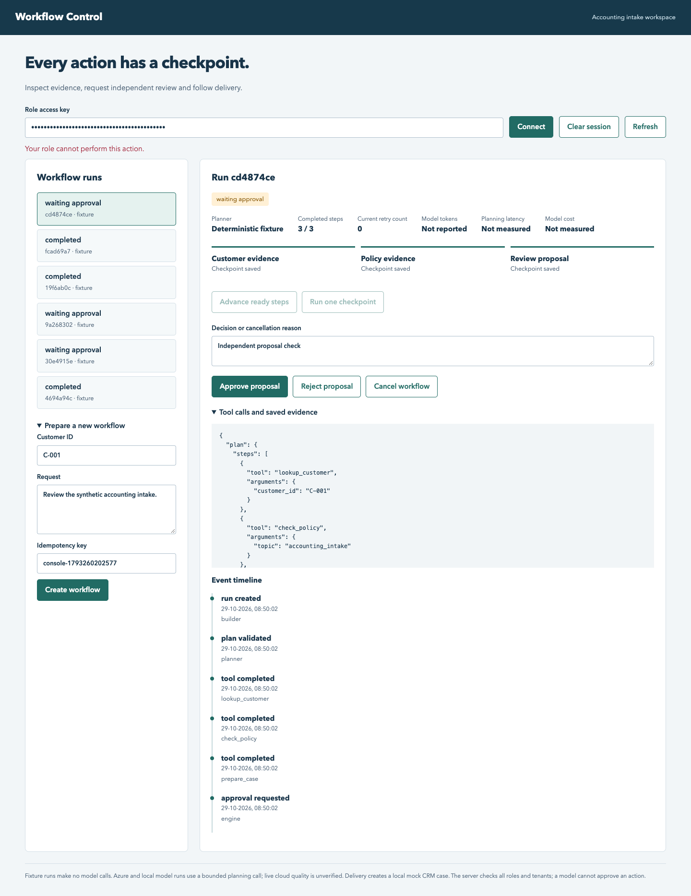
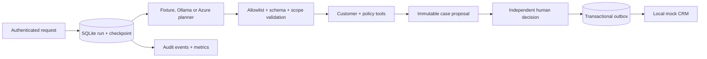

# Agentic Workflow Platform

[Portfolio case study](https://github.com/phlppgdfry/ai-transformation-playbook/tree/portfolio/enterprise-quality-2026-10-29) · [Current release evaluation](docs/release.md) · [Capability evidence](evidence/release-2026-10-30/FEATURES.md). Local checks are recorded; hosted CI and cloud runtime remain separately unverified.

A durable accounting-intake workflow that turns untrusted requests into **reviewable tool proposals**, waits for an independent approver, then writes a case into a local mock CRM. Built for an AI consultant portfolio: it demonstrates where model freedom ends and application controls begin.

## Portfolio update — 29 October 2026

A workflow inspector at `/console`, persisted cancellation, server-scoped invoice/policy HTTP tools and bounded request security controls. [Genuine local Qwen tool calling](docs/local-inference.md) was also executed; model usage and planning latency are recorded separately from fixture runs.

[Integration and limitations](docs/portfolio-integration.md) · [Current evidence matrix](evidence/FEATURES.md)



**Status:** functional local reference implementation with automated tests. It has not been deployed or validated against a live Azure resource. It is not an enterprise SaaS product, a real ERP connector, or evidence of professional production experience.

## What runs today

- FastAPI REST API and generated OpenAPI/Swagger UI.
- SQLite checkpoints, atomic leases and fencing against stale workers.
- Three explicit specialist tools: customer lookup, policy lookup and case preparation.
- Deterministic fixture planner, plus optional Azure OpenAI v1 and genuine local Ollama tool-calling planners.
- Strict tool schemas, customer-scope checks, a three-step budget and an immutable proposal.
- Tenant isolation and server-configured API-key roles. Requesters cannot approve their own work.
- Persisted exponential backoff, bounded retries and terminal failures.
- Approval-gated outbox and idempotent delivery to **local mock CRM tables**.
- Structured audit events and measured local workflow metrics.

The specialist steps are functions, not separate autonomous LLM agents. Fixture mode contains no model call. Azure and opt-in local Ollama modes use one bounded model planning call; tools and writes remain controlled by the deterministic engine.

## Run in five minutes

Use Python 3.11–3.14. The verified local interpreter was Python 3.13.

```bash
python3 -m venv .venv
. .venv/bin/activate
python -m pip install -e '.[dev]'
python -m workflow_platform.cli
python -m pytest -q
```

The CLI uses a temporary SQLite database and synthetic records. It first prints `waiting_approval` with `case_created: false`, then simulates a distinct reviewer and prints `completed`. It performs no external writes. `--database data/demo.db` retains the demo for restart inspection; repeating it reuses the same idempotency key.

## Start the API

```bash
cp .env.example .env
# Replace the example API keys with random values; keep the role mapping server-side.
set -a
. ./.env
set +a
uvicorn workflow_platform.api:create_app --factory --host 127.0.0.1 --port 8012
```

Open <http://127.0.0.1:8012/docs>, click **Authorize**, and use a configured key. API keys in `.env.example` are public demonstration values, not production credentials. The API refuses to start without a nonempty principal mapping.

1. `POST /runs` with `Idempotency-Key: intake-demo-001` and the body in [examples/request.json](examples/request.json), using a builder key.
2. `POST /runs/{id}/drain` using an operator key. Inspect the proposal and its tool evidence with `GET /runs/{id}`.
3. `POST /runs/{id}/decision` using the **reviewer** key and `{"approve":true,"reason":"Checked synthetic customer and policy evidence"}`.
4. `POST /runs/{id}/drain` using the operator key. Inspect the mock CRM case ID and `GET /runs/{id}/events`.
5. Inspect `GET /metrics` using operator or auditor credentials.

`drain` advances at most eight ready checkpoints and stops at approval or backoff. There is deliberately no unattended scheduler: run `tick` from an authenticated scheduler, or implement a dedicated worker using `Engine.tick`. A request replay returns the original run (`created: false`); reuse with different content returns HTTP 409.

## Azure mode

Set `PLANNER_MODE=azure`, `AZURE_OPENAI_ENDPOINT`, `AZURE_OPENAI_DEPLOYMENT` and `AZURE_OPENAI_API_KEY` in the process environment. The resource endpoint must be HTTPS on an Azure OpenAI/Foundry resource domain, without an API path. The adapter calls `/openai/v1/chat/completions` with function-tool schemas. Select a deployment that supports function calling and multiple tool calls. A model that returns a refusal, malformed arguments, extra tools or the wrong order fails closed; it never silently falls back to fixture mode.

The adapter is verified with an HTTP mock transport, **not live cloud inference**. One-call planning of three tools is intentionally restrictive and may reject otherwise reasonable model plans. Start a new run after changing planner mode: existing runs preserve their mode. Raw requests are sent to Azure only in explicitly configured Azure mode. Do not use customer data in this portfolio setup.

## Architecture



See [architecture](docs/architecture.md), [security](docs/security.md), [runbook](docs/runbook.md), [business case](docs/business-case.md), [learning guide](docs/learning.md), [demo script](docs/demo-script.md), and [verification evidence](docs/verification.md).

## Reproducibility and container

`requirements.lock` records the exact environment used for verification. To reproduce it, install that file before `pip install -e . --no-deps`. CI is configured for Python 3.11 and 3.13 with the same lock; hosted results must be inspected separately. Docker uses a non-root Python 3.13 container and persists `/app/data` in a named volume:

```bash
docker compose up --build
```

Compose requires `.env`. Container execution is a supported recipe; see verification evidence for what was actually run. Bind is restricted to local loopback on the host. Do not expose the sample API directly to the internet.

## Limits that matter

SQLite is suitable for this single-host demonstration, not a distributed fleet. The outbox and mock CRM share one database: this proves atomic local delivery, not exactly-once external API effects. A real CRM integration needs remote idempotency keys, reconciliation and uncertain-outcome handling. Static API keys are a local demonstration of authorization; enterprise identity needs Entra ID validation, tenant configuration, key rotation, TLS and centrally enforced policy. Audit records are append-only through the application API but a database administrator can edit them. There is no automatic legal compliance certification, managed identity, cloud telemetry exporter, MCP transport or live Copilot integration in this repository.

## Ownership

AI-assisted implementation; independently explaining, changing and debugging it remains the candidate's responsibility. The exercises in `docs/learning.md` are deliberately marked **not yet assessed**. Only claim skills you can demonstrate yourself.

License: MIT.
