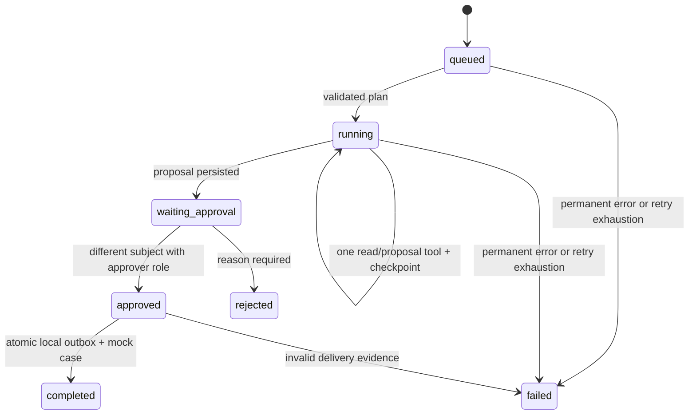

# Architecture and decisions

## State machine

Transient dependency failures retain the current state and cursor, increment `attempts` and set `next_attempt_at`. The default delays are 2 and 4 seconds; failure on the third attempt is terminal. A successful checkpoint resets the per-step attempt count. Waiting and terminal states never acquire a worker lease.

## Transaction boundaries

Request creation, payload hash and the initial audit event commit together. An idempotency key is scoped to tenant + creating subject. Replaying identical content returns the original run; a changed payload conflicts. Different requesters may legitimately use the same key.

A worker claims a run in `BEGIN IMMEDIATE`, storing an unpredictable token and 180-second deadline. Model calls and read-only tools execute outside the transaction. Every checkpoint rereads the lease and deadline before committing. Expired workers are fenced even if they finish after a replacement worker has taken over. Local tools are read/propose only; they must never be changed to perform external writes in this phase.

Tool results have `(run_id, step)` uniqueness. Each successful tool result, cursor advance and audit event commits together. A crash before commit leaves no receipt; rerunning reads is safe. The current tools read in-memory fixtures and prepare a local proposal. A model never receives database credentials, SQL execution, shell access, arbitrary URLs or a write tool.

Approval is transactional: verify tenant, role, different creating subject, waiting state and stored proposal; persist the decision; enqueue the exact proposal; change status. No client-supplied role, revised proposal or AI approval flag is accepted. The separate mock-delivery checkpoint checks an approval decision again, inserts a CRM case and marks the outbox delivered in one database transaction. Unique `run_id` constraints prevent duplicate local deliveries.

## Deliberate technology choices

- **FastAPI/Pydantic:** validated HTTP inputs, tool contracts and generated OpenAPI.
- **SQLite:** easy reproducibility and strong single-host transaction semantics. Short writes serialize; a distributed deployment should move to a server database and distributed job coordination.
- **Explicit state machine:** inspectable recovery and authorization. A framework is not needed for a fixed three-step process. This is not a LangGraph or Microsoft Agent Framework example.
- **Azure REST adapter:** small, inspectable v1 tool-calling boundary. It is optional, isolated and HTTP-contract tested. It uses a configured API key; managed identity is a future enterprise integration.
- **Bounded planning:** three tools in one validated plan reduces flexibility and limits blast radius. This is planned tool orchestration, not an open-ended reasoning loop. Customer and policy outputs do not feed a second model call; the reviewer compares them with the proposal.

## API and data map

`runs` holds request, mode, plan, checkpoint and lease metadata. `receipts` stores read/proposal results. `decisions` holds reviewer, reason and time. `outbox` stores approved proposals. `crm_cases` is the mock external system. `events` holds a chronological application audit trail.

All run routes filter by the authenticated tenant. GET endpoints are visible to configured principals in that tenant; this is a coarse-grained tenant model, not per-document discretionary access. `/metrics` is tenant-scoped and restricted to operator/auditor. `/health` reveals only status and adapter mode. OpenAPI is in [openapi.json](openapi.json).

## Enterprise extensions and acceptance criteria

A real connector needs customer-approved API permissions, per-destination idempotency, timeout-after-write reconciliation, dead-letter handling and integration tests in a sandbox. Entra ID, managed identity, private networking, backup/restore drills and immutable audit export require a real environment. Before real data, agree retention, lawful basis and processing contracts with the organization's responsible owners. These are outstanding implementation and review steps, not implied capabilities.
